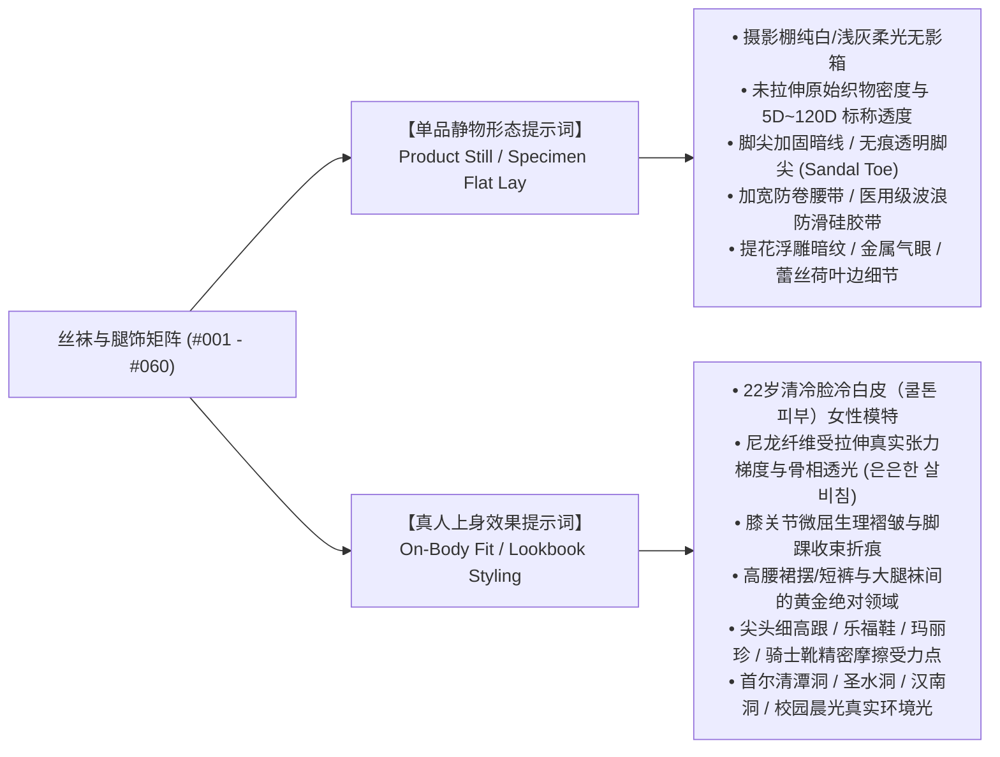

# Iris (虹镜) · 韩国篇 · 丝袜与腿饰矩阵总览

> **The Aperture of Optics, The Soul in the Iris.**
> 本矩阵已全面升级为 **「双图架构」（Dual-Image Architecture）**，全量覆盖 **#001 - #060** 共 60 套工业级丝袜与腿饰体系。
> 告别单提示词局限，每个条目均严格配备「单品静物形态」与「真人上身效果」两套独立提示词代码块，满足商业产品静物目录拍摄与先锋时尚 Lookbook 上身穿搭的双向需求。

---

## 架构升级：双图体系（Dual-Image Architecture）规范

在 AI 图像生成与虚拟人摄影工程中，丝袜材质与腿饰表现极度依赖物理光学属性与穿戴张力。为此 Iris 确立了工业级双图控制架构：

### 标准条目结构规范
全量 60 个条目均保持统一规范的 6 维工业级数据格式：
1. **本土/日常叫法**：韩语原名与圈内地道术语（如 `10데니아 시스루 검스`、`페이크 살스`、`루즈삭스`）；
2. **时尚/流行流派**：国际时装界权威流派英文术语；
3. **视觉特征与材质工艺**：丹尼尔数 (Denier)、混纺成分、编织密度、抗脱丝工艺、防滑硅胶带、踩脚剪裁等工学细节；
4. **穿搭场景与鞋履搭配**：首尔本土精准地标场景、服饰版型与鞋履精确匹配；
5. **【单品静物形态提示词】**：无模特商业产品棚拍、平铺或隐形假人腿、8K纯净度（独立代码块）；
6. **【真人上身效果提示词】**：22岁冷白皮模特上身、肌肉张力、生理折痕、鞋袜互作用、真实环境光（独立代码块）。

---

## 目录检索与类型分类表

| 序号 | 独立分类文件 | 条目区间 | 核心美学定位与覆盖品类 |
|:---:|:---|:---:|:---|
| 01 | [**分类一 · 极透与半透黑丝系列**](01_极透与半透黑丝.md) | #001 - #010 | 10D~80D 极透蝉翼、15D职场柔光、20D水光油亮、30D柔雾炭灰、40D微压修身、80D天鹅绒不透、120D强压塑形、10D暖咖啡棕、15D无缝透明脚尖、20D硅胶防滑大腿长袜 |
| 02 | [**分类二 · 清冷自然与水光肉丝/肤色系列**](02_冷白素颜水光肉丝.md) | #011 - #020 | 5D冷白陶瓷素肌、10D闪光水光肉丝、15D哑光素颜肉丝、8D珍珠云母微闪、15D健康美黑小麦金、10D温润浅奶茶、20D双层提臀收腹、假透肉秋冬防寒神器、10D大腿过膝肉丝、5D露趾凉鞋专用丝袜 |
| 03 | [**分类三 · 复古线条、提花、暗纹与字母印花系列**](03_中缝后线条与字母提花.md) | #021 - #030 | 15D后中缝复古黑线 (Back Seam)、波尔卡小圆波点、大牌双字母老花提花 (Monogram)、英伦几何菱格纹、脚踝单侧蔓藤玫瑰、垂直细竖条纹、散落极细小爱心、摇滚哥特字母涂鸦、巴洛克卷草蕾丝、小腿蝴蝶结后系带 |
| 04 | [**分类四 · 纯白丝袜、芭蕾核与学院连裤袜系列**](04_纯白丝袜与芭蕾核连裤袜.md) | #031 - #040 | 40D半透纯白芭蕾丝袜、80D纯白不透羊奶白、细竖坑条纯棉线连裤袜、纯白满地蕾丝镂空花纹、纯白丝带交叉系带大腿袜、30D浅奶油米白半透丝袜、珍珠白水光贝母微闪、纯白小碎花暗纹、纯白大腿过膝宽蕾丝袜、15D纯白及膝学生中筒袜 |
| 05 | [**分类五 · 网袜、吊袜带、长筒大腿袜与性感辣妹系列**](05_先锋微网袜与大腿蕾丝长袜.md) | #041 - #050 | <1mm 极细密微网眼黑网袜、5mm 经典菱格中孔街头网袜、1.5cm 粗狂大网眼朋克网袜、8cm 超宽重工蕾丝大腿黑袜、真皮金属双排扣吊袜带套装、十字交错缠绕绑带黑丝、手工故意抽丝破坏黑丝、假大腿一体拼色连裤袜、侧缝金属气眼穿绳黑长袜、15D 深酒红透肉冷艳丝袜 |
| 06 | [**分类六 · JK制服、洛丽塔与韩国女高白丝与腿饰进阶系列**](06_JK制服与洛丽塔白丝腿饰.md) | #051 - #060 | 假两件拼接透白连裤袜、JK 经典不透纯白过膝长筒袜、韩国女高粗罗纹纯白堆堆袜、洛丽塔双层蕾丝木耳边短袜、洛丽塔巴洛克浮雕暗纹白丝、洛丽塔后系束腰抽绳珍珠白丝、芭蕾纯欲 40D 消光天鹅绒白丝、芭蕾足弓踩脚微透纯白连裤袜、平成涩谷辣妹 70cm 重磅大泡泡袜、韩国秋冬私立女高麻花微喇羊毛腿套 |

---

## 跨模型使用指南

- **ChatGPT (Image 2.5 / DALL-E 3)**：直接复制独立代码块中的完整提示词。单品静物提示词适合生成 1:1 或 3:4 商业画册，真人上身提示词适合全景 Lookbook 生成；
- **Seedream 5.0 Pro (豆包 / 即梦)**：真人上身提示词已预置 `（参考垫图：上传标准母图）`，垫入统一模特正脸母图可锁死面部五官与肤色特征，专注生成腿部丝袜质感与鞋履搭配；
- **Gemini (Imagen 3)**：超长文本语义解析优势明显，提示词中严密的织物经纬、光学折射与环境光照叙事将得到极其真实还原；
- **在线可视化调音台**：可直达 [Iris Web Studio](https://noahvisualsx.github.io/Iris/)，支持八轨参数混音调节并支持剪贴板 `⌘V` 直贴渲染参考图。
