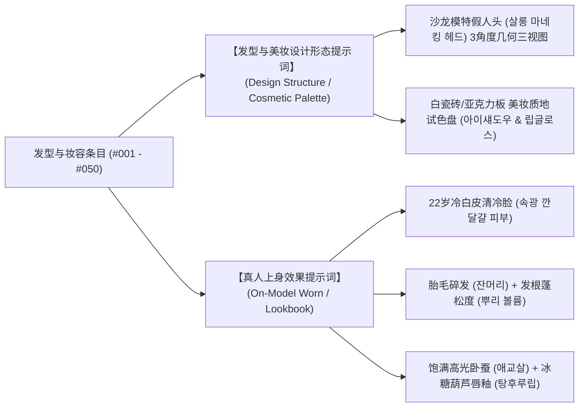

# Iris (虹镜) · 韩国篇 · 发型与妆容矩阵总览

> **The Aperture of Optics, The Soul in the Iris.**
> 本模块已全量升级为**「双图架构 (Dual-Image Architecture)」**，按「一个类型一个文件」精细拆解为 **5 个核心分类独立文件**，共收录 **50 组工业级发型与妆容条目（#001 - #050）**。

---

## 双图架构设计理念 (Dual-Image Architecture)

为了同时满足**美学形态解构（设计单品标本）**与**商业级上身效果（真人试戴实拍）**的双重视觉需求，每个发型与美妆条目均标配两张顶级工业生图指令：



| 图像形态 | 核心视角与视觉构成 | 生图核心应用场景 |
|:---|:---|:---|
| **图一 · 发型与美妆设计形态** | 极简沙龙高定假人头模三视图（正、侧45°、后）、发丝走向力学标本、精密发尾切线、白瓷砖/磨砂亚克力美妆色板、液体水光唇釉水滴与眼影膏体微距特写 | 发型师剪裁蓝图对照、美妆产品研发提案、高阶视觉情绪板（Moodboard）、单品形态标本归档 |
| **图二 · 真人上身实拍效果** | 22岁冷白皮女性，自然发根立体蓬松（뿌리 볼륨）、发际线细软胎毛碎发（잔머리）、透亮水光内透肌（속광）、立体高光卧蚕（애교살）、晶莹糖葫芦镜面唇釉（탕후루 립）与场景面部氛围光 | 商业摄影样片、社交媒体KOL上身示范、虚拟人一致性穿搭装扮、即刻实拍成片交付 |

---

## 目录检索与类型分类表

| 序号 | 细分类型分类文件 | 覆盖条目编号 | 核心美学与视觉特征 |
|:---:|:---|:---:|:---|
| 01 | [**分类一 · 高冷高级感与一刀切清冷妆发系列**](01_高冷高级感与一刀切清冷妆发.md) | #001 - #010 | 齐下巴一刀切短发、贴头皮低马尾、露额大背头、清冷哑光瓷肌、冷灰棕 |
| 02 | [**分类二 · 初恋清纯、空气刘海与元气少女系列**](02_初恋清纯与空气刘海元气少女.md) | #011 - #020 | 空气八字刘海、鬓角微卷胎毛、随性鲨鱼夹发髻、水光卧蚕、糖葫芦草莓果汁唇 |
| 03 | [**分类三 · 浪漫大波浪、法式卷与名媛财阀千金系列**](03_浪漫大波浪与名媛财阀千金.md) | #021 - #030 | 高颅顶大S波浪女神卷、法式慵懒水波纹、羽毛剪层次卷、大地色贵气消肿眼妆、名媛蚕茧低发髻 |
| 04 | [**分类四 · 千禧复古、嬉皮士卷与 Y2K 辣妹系列**](04_千禧复古嬉皮士与Y2K辣妹.md) | #031 - #040 | 蓬松细卷嬉皮士卷发、触角龙须两缕细刘海、羽毛刺猬碎发丸子头、白金漂染冷白长直、银白线条挑染 |
| 05 | [**分类五 · K-Pop 爱豆舞台概念与前卫视觉系列**](05_爱豆舞台概念与前卫视觉.md) | #041 - #050 | 女团太阳花分段假睫毛、梦幻初雪冰浅粉发、雾霾蓝灰渐变、金属发环编发、水钻泪痕与美人痣 |

---

## 条目数据结构规范

每个条目均严格遵守统一工业级美学格式排版：

```markdown
### #编号 【中文条目名称】
- **本土/日常叫法**：`韩语原名 (音译与本土口语俗称)`
- **时尚/流行流派**：`英文流派对应与核心术语`
- **剪裁构造与妆容细节**：发尾基底线、发根力学、胎毛与碎发走向；底妆质地、眼影层次、眼线、睫毛与唇彩质感解剖
- **适用脸型与风格场景**：脸型修饰匹配（鹅蛋/圆脸/方脸/菱形等）及首尔标志性时空场景
- **【发型与美妆设计形态提示词】**：（独立代码块，支持一键复制，精准还原沙龙三视图与试色色盘）
- **【真人上身效果提示词】**：（独立代码块，支持一键复制，22岁冷白皮、胎毛碎发、水光肌与糖葫芦唇）
```

---

## 主流生图模型实操推荐

1. **ChatGPT (Image 2.5)**：
   - 直接全选复制对应条目中的代码块内容粘贴至对话框；
   - 包含中英韩三语专业词汇（`잔머리`, `뿌리 볼륨`, `탕후루 립`, `Sleek Cut` 等），模型对发型几何与美妆质感具备极高识别度。

2. **Seedream 5.0 Pro (火山方舟 / 豆包)**：
   - 执行真人上身提示词时，支持上传标准人脸母图作为参考垫图（权重建议 `0.6 - 0.75`），完美继承发型与妆容细节，同时锁定人物五官一致性；
   - 比例推荐设置为 `3:4`（小红书/Instagram 标准人像比例）。

3. **Gemini (Imagen 3)**：
   - 极佳的长文本语义解构能力，可完整还原自然光漫射、冷白瓷肌水光透感与极细微距发丝空气感。

4. **在线交互调音台**：
   - 访问 [Iris Web Studio](https://noahvisualsx.github.io/Iris/)，支持八轨微观参数自由混音，并支持剪贴板 `⌘V` 直贴生成参考图。
