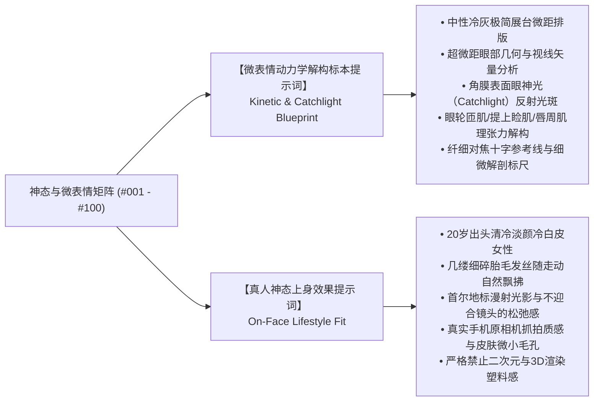

# Iris (虹镜) · 韩国篇 · 神态与微表情矩阵总览

> **The Aperture of Optics, The Soul in the Iris.**
> 本矩阵已全量升级为 **「双图架构」（Dual-Image Architecture）**，全量覆盖 **#001 - #100** 共 100 套工业级神态与微表情体系。
> 每个条目均严格配备「微表情动力学解构标本」与「真人神态上身效果」两套独立提示词代码块，既可用于眼神光/眼睑张弛/唇部肌理的医学美学图谱解构，亦可直接用于高质感写实生活写真抓拍。

---

## 架构升级：双图体系（Dual-Image Architecture）规范

在虚拟人肖像摄影中，神态的真实感取决于眼球角膜的反光矢量（Catchlight）与微表情肌肉动力学张力。为此 Iris 确立了工业级双图控制架构：

---

## 目录检索与类型分类表

| 序号 | 细分类型分类文件 | 覆盖内容与美学定位 | 规格架构 |
|:---:|:---|:---|:---:|
| 01 | [**分类一 · 清冷疏离与高级厌世神态**](01_清冷疏离与高级厌世神态.md) | 视线偏离镜头15度、微阖眼眸、下颌微抬冷淡平静 | 双图架构 · 20独立代码块 |
| 02 | [**分类二 · 慵懒未醒与微醺迷离**](02_慵懒未醒与微醺迷离.md) | 微醉眼波、晨起睡眼惺忪、微张嘴唇露出贝齿 | 双图架构 · 20独立代码块 |
| 03 | [**分类三 · 灵动俏皮与心动初恋**](03_灵动俏皮与心动初恋.md) | 单眼Wink、咬唇浅笑、眼神充满好奇光芒 | 双图架构 · 20独立代码块 |
| 04 | [**分类四 · 知性沉静与专注故事感**](04_知性沉静与专注故事感.md) | 凝神沉思、若有所思望向远方、克制温柔微笑 | 双图架构 · 20独立代码块 |
| 05 | [**分类五 · 瞳孔光斑与眼神光系统**](05_瞳孔光斑与眼神光系统.md) | 环形单点Catchlight、窗外自然漫射光斑、夜景光斑倒影 | 双图架构 · 20独立代码块 |
| 06 | [**分类六 · 不屑嗤笑与傲慢挑衅**](06_不屑嗤笑与傲慢挑衅.md) | 单侧鼻翼轻抽、挑眉冷嘲、下颌微抬上位者俯视审视 | 双图架构 · 20独立代码块 |
| 07 | [**分类七 · 嫌弃嫌恶与生理性不耐烦**](07_嫌弃嫌恶与生理性不耐烦.md) | 鼻翼微抽提上唇肌、转头避让避嫌、看表催促与彻底厌烦 | 双图架构 · 20独立代码块 |
| 08 | [**分类八 · 暗黑气场与神秘心机玩味**](08_暗黑气场与神秘心机玩味.md) | 深渊无光凝视、咬唇算计、猫眼微眯掌控全局的大女主冷艳 | 双图架构 · 20独立代码块 |
| 09 | [**分类九 · 隐忍动容与红眸泪光微漾**](09_隐忍动容与红眸泪光微漾.md) | 下眼睑微红蓄泪、咬下唇强忍哭腔、单颗清泪滑落的电影感破碎 | 双图架构 · 20独立代码块 |
| 10 | [**分类十 · 震惊错愕与警觉凝固瞬间**](10_震惊错愕与警觉凝固瞬间.md) | 瞳孔骤缩震颤、双唇微启呼吸悬停、上提肌警醒与防御定格 | 双图架构 · 20独立代码块 |

---

## 跨模型使用规范

- **ChatGPT (Image 2.5)**：直接复制对应文件中的独立提示词，保持微距质感叙事；
- **Seedream 5.0 Pro (豆包)**：支持标准母图绑定（参考垫图），真实毛孔微质感锁定；
- **Gemini (Imagen 3)**：长文本镜头光影与真实自然叙事；
- **在线调音台**：访问 [Iris Web Studio](https://noahvisualsx.github.io/Iris/) 支持八轨一键混音与剪贴板 `⌘V` 配图。

